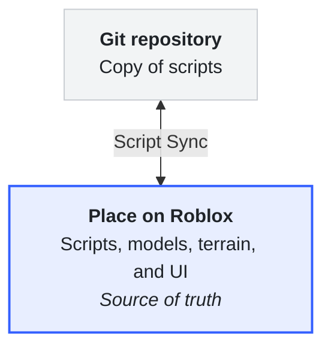
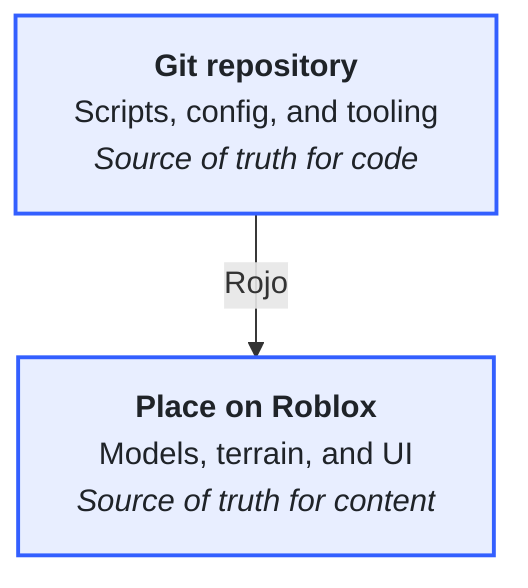
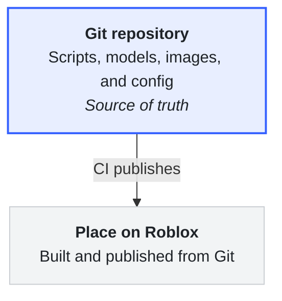
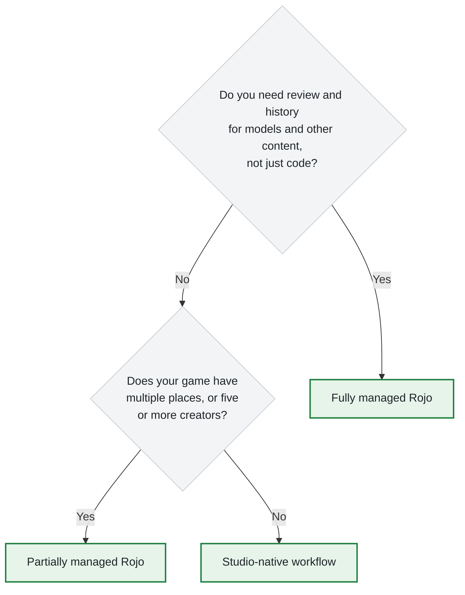
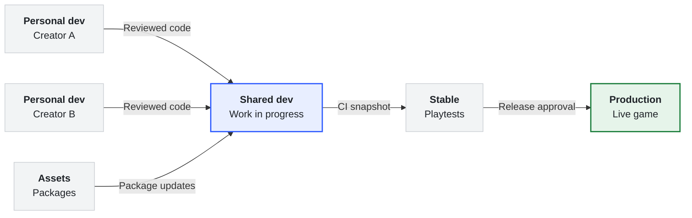

Roblox games live in the cloud by default. Studio saves your places, assets, and scripts to Roblox, and [Version History](./version-history.md) tracks changes to each place. Many teams also want their game in a **version control** system like [Git](https://git-scm.com/) so they can review changes before they land, keep a full history, and automate builds and deploys.

Every version control workflow for Roblox answers one question: where does the **source of truth** live for each part of your game? The three common answers are:

- **Studio-native:** The place on Roblox is the source of truth for everything. Script Sync copies scripts into Git so you can review and track them.
- **Partially managed:** Git is the source of truth for code. The place on Roblox is the source of truth for everything else, like models, terrain, and UI.
- **Fully managed:** Git is the source of truth for the entire game. Places on Roblox are build output that CI publishes from the repository.

This page compares these workflows, describes the tools each one uses, and covers the environments that teams set up around them. To set up a workflow, see [Set up a workflow](#set-up-a-workflow).

<Alert severity="info">
Third-party tools on this page are not maintained by Roblox and can change or stop working at any time. For full reference, see each tool's own documentation.
</Alert>

## Roadmap for file-based workflows

Roblox is working toward first-party, file-based workflows so that teams can use version control without assembling third-party tools. Until those workflows ship, the setups on this page reflect what works for teams today.

## Workflow comparison

<Grid container spacing={2} style={{marginBottom: 24}}>

<Grid item XSmall={12} Medium={4}>

<h4>Studio-native</h4>

</Grid>

<Grid item XSmall={12} Medium={4}>

<h4>Partially managed</h4>

</Grid>

<Grid item XSmall={12} Medium={4}>

<h4>Fully managed</h4>

</Grid>

</Grid>

<table>
  <thead>
    <tr>
      <th></th>
      <th>Studio-native</th>
      <th>Partially managed</th>
      <th>Fully managed</th>
    </tr>
  </thead>
  <tbody>
    <tr>
      <td><b>Good fit for</b></td>
      <td>Teams of fewer than five creators working on a single-place game</td>
      <td>Teams with several programmers, and multi-place games</td>
      <td>Teams that require review and history for every instance and asset</td>
    </tr>
    <tr>
      <td><b>In version control</b></td>
      <td>Scripts</td>
      <td>Scripts, project configuration, and tooling</td>
      <td>Everything, including models and images</td>
    </tr>
    <tr>
      <td><b>Content editing</b></td>
      <td>Team Create</td>
      <td>Team Create and packages</td>
      <td>Files in Git, built by CI</td>
    </tr>
    <tr>
      <td><b>Tools to maintain</b></td>
      <td>None beyond Studio and an editor</td>
      <td>Rojo plus linting and CI tools</td>
      <td>Rojo, merge and asset tools, and a full CI pipeline</td>
    </tr>
  </tbody>
</table>

### Choose a workflow

Start with the simplest workflow that meets your needs. You can move to a more managed workflow later, because none of these tools lock you in. Most teams don't need fully managed Rojo, and it adds significant complexity.

## Tools

Most setups combine a few tools from Roblox with a few from the community.

### Roblox tools

<table>
  <thead>
    <tr>
      <th>Tool</th>
      <th>What it does</th>
      <th>Used in</th>
    </tr>
  </thead>
  <tbody>
    <tr>
      <td><a href="./collaboration.md">Team Create</a></td>
      <td>Real-time collaborative editing in Studio, best suited to building, level design, and art.</td>
      <td>All workflows</td>
    </tr>
    <tr>
      <td><a href="../scripting/sync.md">Script Sync</a></td>
      <td>Syncs scripts in Studio with files on your local disk, in both directions.</td>
      <td>Studio-native</td>
    </tr>
    <tr>
      <td><a href="./assets/packages.md">Packages</a></td>
      <td>Reusable, versioned groups of instances that you can update across places and games.</td>
      <td>Studio-native, partially managed</td>
    </tr>
    <tr>
      <td><a href="./version-history.md">Version History</a></td>
      <td>Saved versions of each place that you can view, compare, and restore.</td>
      <td>All workflows</td>
    </tr>
    <tr>
      <td><a href="../cloud/guides/usage-place-publishing.md">Place publishing API</a></td>
      <td>Open Cloud API that publishes a place file to Roblox. Use it to deploy from CI.</td>
      <td>Partially managed, fully managed</td>
    </tr>
    <tr>
      <td><a href="/cloud/reference/LuauExecutionSessionTask">Luau execution API</a></td>
      <td>Open Cloud API that runs Luau in a place on Roblox servers. Use it to run tests from CI.</td>
      <td>Partially managed, fully managed</td>
    </tr>
    <tr>
      <td><a href="../cloud/guides/usage-assets.md">Assets API</a></td>
      <td>Open Cloud API that uploads and updates assets like images, audio, and models.</td>
      <td>Fully managed</td>
    </tr>
  </tbody>
</table>

### Community tools

<table>
  <thead>
    <tr>
      <th>Tool</th>
      <th>What it does</th>
      <th>Used in</th>
    </tr>
  </thead>
  <tbody>
    <tr>
      <td><a href="https://rojo.space/">Rojo</a></td>
      <td>Syncs files on disk into Studio through a local server and Studio plugin, and builds place and model files from a project file. The `rojo syncback` command, in Rojo 7.7 and later, converts an existing place into project files.</td>
      <td>Partially managed, fully managed</td>
    </tr>
    <tr>
      <td><a href="https://github.com/rojo-rbx/rokit">Rokit</a></td>
      <td>Toolchain manager. Pins tool versions so everyone on the team uses the same ones.</td>
      <td>Partially managed, fully managed</td>
    </tr>
    <tr>
      <td><a href="https://wally.run/">Wally</a></td>
      <td>Package manager for community Luau libraries.</td>
      <td>Partially managed, fully managed</td>
    </tr>
    <tr>
      <td><a href="https://github.com/lune-org/lune">Lune</a></td>
      <td>Standalone Luau runtime, commonly used for build, deploy, and automation scripts.</td>
      <td>Partially managed, fully managed</td>
    </tr>
    <tr>
      <td><a href="https://github.com/Kampfkarren/selene">selene</a></td>
      <td>Luau linter.</td>
      <td>All workflows</td>
    </tr>
    <tr>
      <td><a href="https://github.com/JohnnyMorganz/StyLua">StyLua</a></td>
      <td>Luau code formatter.</td>
      <td>All workflows</td>
    </tr>
    <tr>
      <td><a href="https://github.com/JohnnyMorganz/luau-lsp">Luau Language Server</a></td>
      <td>Autocompletion and type checking in external editors.</td>
      <td>All workflows</td>
    </tr>
    <tr>
      <td><a href="https://github.com/Roblox/tarmac">Tarmac</a></td>
      <td>Uploads images from disk to Roblox and generates a module that maps file paths to asset IDs.</td>
      <td>Fully managed</td>
    </tr>
    <tr>
      <td><a href="https://github.com/kennethloeffler/rbx-merge">rbx-merge</a></td>
      <td>Git diff and merge driver for `.rbxl`, `.rbxlx`, `.rbxm`, and `.rbxmx` files. Shows readable diffs and merges non-conflicting changes at the property level.</td>
      <td>Fully managed</td>
    </tr>
  </tbody>
</table>

To install and run Rojo, see [Rojo](./rojo/index.md). For Rokit, Wally, linters, and other tools, see [Third-party tools](./external-tools.md).

## Environments

Teams that use version control usually also separate their work into **environments**, so that unfinished changes never reach players. Instead of one place that everyone edits, each environment is its own place.

We recommend creating each environment as a separate **game** under the same [group](./groups.md), rather than as separate places within one game. Data stores, secrets, and other cloud services are scoped to the game, so separate games keep test data out of production.

A typical setup has these environments:

<table>
  <thead>
    <tr>
      <th>Environment</th>
      <th>Purpose</th>
      <th>Who updates it</th>
    </tr>
  </thead>
  <tbody>
    <tr>
      <td><b>Personal dev</b></td>
      <td>Each creator's own copy of the dev place for day-to-day work.</td>
      <td>That creator</td>
    </tr>
    <tr>
      <td><b>Shared dev</b></td>
      <td>The combined, unstable set of features that the team is working on.</td>
      <td>Programmers sync reviewed code, and artists copy in approved content.</td>
    </tr>
    <tr>
      <td><b>Assets</b></td>
      <td>The canonical versions of packages, like characters, building kits, and set dressing.</td>
      <td>Artists</td>
    </tr>
    <tr>
      <td><b>Stable</b></td>
      <td>A snapshot of shared dev at a regular interval, such as for weekly playtests.</td>
      <td>CI only</td>
    </tr>
    <tr>
      <td><b>Production</b></td>
      <td>The live, public game.</td>
      <td>Copied from stable after release approval</td>
    </tr>
  </tbody>
</table>

### Create a personal dev place

1. Open the shared dev place in Studio.
1. Select **File** ⟩ **Publish As**.
1. Select the group that owns your dev games.
1. Publish the place as a new game with a name that identifies you and the project, like `USER / YourName - ProjectName`.
1. Close the shared dev place and open your new personal copy.

Use consistent names for every environment, such as `DEV - ProjectName`, `ASSET / ProjectName`, and `STABLE / ProjectName`, so that the team can tell them apart on the **Creator Dashboard**.

## Set up a workflow

<table>
  <thead>
    <tr>
      <th>Workflow</th>
      <th>Setup guide</th>
    </tr>
  </thead>
  <tbody>
    <tr>
      <td>Studio-native</td>
      <td><a href="../scripting/sync.md#use-script-sync-with-a-team">Use Script Sync with a team</a></td>
    </tr>
    <tr>
      <td>Partially managed</td>
      <td><a href="./rojo/partially-managed.md">Partially managed Rojo</a></td>
    </tr>
    <tr>
      <td>Fully managed</td>
      <td><a href="./rojo/fully-managed.md">Fully managed Rojo</a></td>
    </tr>
  </tbody>
</table>

## Troubleshoot common problems

<table>
  <thead>
    <tr>
      <th>Problem</th>
      <th>Fix</th>
    </tr>
  </thead>
  <tbody>
    <tr>
      <td>Testing in a dev place changes production data.</td>
      <td>Dev and production are places in the same game, so they share data stores. Move each environment into its own game.</td>
    </tr>
    <tr>
      <td>Teammates overwrite each other's script changes.</td>
      <td>Two people are syncing the same scripts into one Team Create session. Sync code into personal dev places and merge through Git.</td>
    </tr>
    <tr>
      <td>A fix to one copy of a script doesn't apply to the others.</td>
      <td>Copying a script creates an independent copy. Put shared behavior in a `Class.ModuleScript` and attach it to instances with `Class.CollectionService` tags.</td>
    </tr>
    <tr>
      <td>Server-only code is visible to clients.</td>
      <td>Modules in containers that replicate to clients, like `Class.ReplicatedStorage`, are sent to clients. Keep server-only modules in `Class.ServerScriptService` or `Class.ServerStorage`.</td>
    </tr>
  </tbody>
</table>
