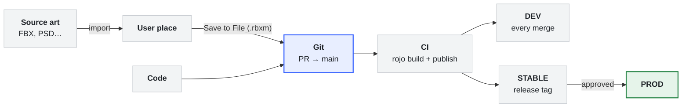

A team workflow for Roblox projects where **everything lives in Git**: code, config, art and level layout. Places are built from the repo, never edited by hand, and every build can be traced to a commit.

## How this changes the role of Studio

This workflow treats Roblox Studio as exactly two things:

1. **A deployment target.** Rojo assembles the `.rbxl` place file from the repo. Studio opens it, runs it and publishes it, but the place is never the source of truth.
2. **A tool for building `.rbxm` models.** You build or edit one asset or one area in Studio, then export it to the repo with **Save to File**. Rojo puts the exported files together into the place.

**The repo, not Studio, defines how the game is assembled.** The project file and the folder layout say which `.rbxm` files go where. You export those files from Studio one at a time.

Because of this, the usual Studio workflows **don't apply**:

- **No Team Create.** Nobody co-edits a shared place. Collaboration happens through branches and PRs.
- **No iterative world editing in a live place.** You can't build up a level over time in Dev and save the place. Any edit that isn't exported to a `.rbxm` and committed is thrown away at the next build.
- **No packages.** Git provides the versioning and sharing that packages would.

If your team relies on Team Create and editing levels in place, use the Rojo + Packages workflow instead.

## The short version

- **Code, config, art and levels** live in Git under `src/`. Art and level pieces are `.rbxm` files.
- **[Rojo](https://rojo.space) builds the place** from the repo. Code iterates live with `rojo serve`. Art changes come in by rebuilding the place.
- **Everyone works in their own User place** and submits changes through PRs.
- **CI builds and publishes** Dev on every merge to `main`, and Stable from release tags.
- **Prod** is the live game.



## Places

All places are owned by the project **group**.

| Place | Purpose | Who changes it | How | Name |
| --- | --- | --- | --- | --- |
| **User** | Your personal workspace, built from your branch | You | `rojo build` + `rojo serve` | `USER / [Name] - [Project] - [Level]` |
| **Dev** | Latest `main`, used for team testing | CI only | Built and published on every merge | `DEV - [Project]` |
| **Stable** | A tagged build, used for playtests | CI only | Built and published from a release tag | `STABLE / [Project]` |
| **Prod** | The public game | Release owner, with approval | CI publishes an approved Stable build | `[Project]` |

**Never edit Dev or Stable by hand.** The next CI publish overwrites them. If something needs changing, change it in Git.

## Where things go

| What | Where | Format |
| --- | --- | --- |
| Code (systems, libraries) | `src/…/Systems`, `src/…/Libraries` | `.luau` |
| Typed config and definitions | `src/…/ManagedContent/` | `.luau`, `.model.json` |
| Art assets (props, kit pieces, characters, VFX) | `src/…/ManagedContent/Art/` | `.rbxm`, **one file per asset** |
| Level layout | `src/Workspace/Areas/` | `.rbxm`, **one file per area** |
| Lighting, Workspace and service settings | `default.project.json` | `$properties` |
| Source art (FBX, PSD, textures) | Git LFS or Perforce | Native formats |

Some rules for organising files:

- **One file per asset or area** keeps diffs small and merge conflicts rare. The file name becomes the instance name in the built place.
- **Use `.rbxm` for art and levels.** Binary files are much smaller than XML when they contain meshes. Use [rbx-merge](https://github.com/kennethloeffler/rbx-merge) to diff and merge them; see below.
- **Every setting has to be in Git.** A built place only contains what's in the repo. Settings like Lighting, `Workspace.StreamingEnabled` and `Players.CharacterAutoLoads` go in the project file. Anything only set in Studio is lost on the next build.
- **Terrain is binary**, and Rojo can't live-sync it. Keep it in its own file, owned by one person. Confirm it survives a `rojo build` before you rely on it.

### Project file

```json
{
  "name": "MyGame",
  "tree": {
    "$className": "DataModel",
    "ReplicatedStorage": { "$path": "src/ReplicatedStorage" },
    "ServerScriptService": { "$path": "src/ServerScriptService" },
    "Workspace": {
      "$path": "src/Workspace",
      "$properties": { "StreamingEnabled": true }
    },
    "Lighting": {
      "$properties": { "Technology": "Future", "ClockTime": 14 }
    }
  }
}
```

### Repo layout

```text
src/
├── ReplicatedStorage/
│   ├── Systems/
│   ├── Libraries/
│   └── ManagedContent/
│       ├── ItemDefinitions/
│       └── Art/
│           ├── Props/Crate.rbxm
│           └── Characters/Hero.rbxm
├── ServerScriptService/
│   ├── Systems/
│   └── ManagedContent/
└── Workspace/
    └── Areas/
        ├── Town.rbxm
        └── Forest.rbxm
```

## Why art is rebuilt, not live-synced

Rojo's live sync (`rojo serve`) goes through the Studio plugin API, and that API can't set some properties: `MeshPart.MeshId`, terrain, and CSG parts. `rojo build` writes the place file directly and doesn't have this limitation. See [Rojo sync details](https://rojo.space/docs/v7/sync-details/).

So the rules are:

- **Code and config changes:** `rojo serve` + Connect, as normal.
- **Art and level changes:** rebuild the place with `rojo build`, then reopen it.

## Setup (once per project)

1. **Clone the repo** and install the toolchain with [Rokit](https://github.com/rojo-rbx/rokit): run `rokit install`.
2. **Set up rbx-merge** so `.rbxm` files diff and merge properly:
   - Once per repo, one person runs this and commits the result: `rbx-merge install --write-gitattributes`.
   - Once per clone, everyone runs `rbx-merge install`, then `rbx-merge doctor` to check it worked.
3. **Set up source art storage:** install Git LFS (`git lfs install`), or set up access to the project's Perforce depot.
4. **Build your User place:**
   - Run `rojo build default.project.json -o build/place.rbxl`, then open `build/place.rbxl` in Studio.
   - To test with others, choose **File → Publish As**, select the project group, and name it `USER / [Name] - [Project] - [Level]`.
5. **Connect Rojo:** run `rojo serve`, then click **Connect** in the Studio Rojo plugin.

## Engineers: the code loop

1. Make a branch off `main`.
2. Build your User place (Setup step 4) and connect `rojo serve`.
3. Work as normal. When you pull art changes, rebuild and reopen the place.
4. Run `stylua` (formatting) and `selene` (linting) before opening a PR.
5. Open a PR and get it reviewed. CI should run a test `rojo build` on every PR.
6. Merge to `main`. CI publishes the new build to Dev.

## Artists: the asset loop

### Importing source art

1. Keep the source files (FBX, PSD, textures) in Git LFS or Perforce.
2. Import them with Studio's 3D Importer, **uploading to the project group**. The assets then belong to the group, and every place built from the repo can use them. See [Asset privacy](https://create.roblox.com/docs/projects/assets/privacy).
3. Changing a mesh or texture means uploading it again, which gives a new asset ID. Update the instance that uses it and re-save the `.rbxm`.

### Adding or changing an asset

1. Make a branch, build your User place, and open it.
2. Build or edit the asset in Studio. Keep each asset as a single **Model**.
3. Right-click it, choose **Save to File** → `.rbxm`, and save it to its path under `ManagedContent/Art/…`. Use the same path to overwrite an existing asset.
4. Rebuild the place and check the asset looks right.
5. Commit and open a PR. Reviewers can see what changed with `git diff`, which rbx-merge turns into readable text.
6. Merge. CI publishes the change to Dev.

### Level layout

- Each area is one `.rbxm` under `src/Workspace/Areas/`.
- Edit the area in your User place, then save it back with **Save to File** over the same file.
- **Rebuilding throws away any unsaved Studio changes.** Save to file before you rebuild or pull.
- Agree who owns each area. Two people editing the same area will usually conflict.

### Placing assets in levels

- Built places have no package-style links. A copy of an asset placed in an area doesn't update when you change the original asset file.
- **Option 1 (recommended):** for kit pieces you reuse a lot, place **markers** in the level instead of copies, for example a tagged Part named `Crate`. A script swaps each marker for the asset from `ManagedContent/Art` at runtime. Changing the asset file then updates every placement.
- **Option 2:** place full copies, and update them by hand when the original asset changes.

## Merging and conflicts

- **rbx-merge** merges `.rbxm` files instance by instance. If two people change _different_ things in the same file, the merge completes on its own.
- **If both sides change the same property,** Git reports a conflict and rbx-merge writes a report to `.rbxmerge/<file>/conflicts.txt`. To resolve it:
  1. In the report, set `resolution = ours | theirs | base` for each conflict.
  2. Run `rbx-merge resolve --stash-dir .rbxmerge/<file> --out <file>`.
  3. Run `git add <file>` and continue the merge.
- **Source art can't be merged.** Use LFS file locking (`git lfs lock`) or Perforce exclusive checkout so that only one person edits a file at a time.

## CI: build and publish

The pipeline needs an [Open Cloud](https://create.roblox.com/docs/cloud/guides/usage-place-publishing) API key with the **assets** permission and **Read** and **Write** access, plus each place's ID. Store them as CI secrets.

| Trigger | Steps |
| --- | --- |
| **Every PR** | `rojo build`, `stylua --check`, `selene`. Fail the PR if any of them fail. |
| **Merge to `main`** | `rojo build -o build/place.rbxl`, then publish it to **Dev**. |
| **Release tag** | Build the tagged commit and publish it to **Stable**. |
| **Approved release** | Publish the same tagged build to **Prod**. |

Every build comes from a commit, so you can rebuild and republish any earlier version, including after a bad release.

## Communication

Give each project a general channel, an engineering channel (PR links, technical discussion), and an art channel (WIPs, reviews).

## Reference

- [Rojo project format](https://rojo.space/docs/v7/project-format/)
- [Rojo sync details](https://rojo.space/docs/v7/sync-details/)
- [rbx-merge](https://github.com/kennethloeffler/rbx-merge)
- [Git LFS](https://git-lfs.com)
- [Asset privacy](https://create.roblox.com/docs/projects/assets/privacy)
- [Open Cloud place publishing](https://create.roblox.com/docs/cloud/guides/usage-place-publishing)
