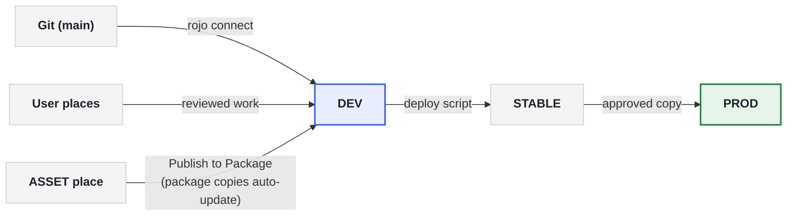

A team workflow for Roblox projects that keeps code in Git, keeps art versioned with packages, and lets everyone work without overwriting each other's changes.

## The short version

- **Code** lives in Git and gets into Studio through [Rojo](https://rojo.space).
- **Art** lives in Roblox as [packages](https://create.roblox.com/docs/projects/assets/packages). The originals sit in an **Asset place**, and copies in the Dev place update automatically.
- **Everyone works in their own User place**, then brings finished work into the shared **Dev place**.
- **Stable** is a frozen snapshot of Dev for playtests. **Prod** is the live game.



## Places

All places are owned by the project **group**. Always check the group is selected before you click **Publish As**.

| Place | Purpose | Who changes it | How | Name |
| --- | --- | --- | --- | --- |
| **User** | Your personal day-to-day workspace, copied from Dev | You | Rojo connect + Studio | `USER / [Name] - [Project] - [Level]` |
| **Dev** | Shared, unstable combination of everyone's work | Everyone, after review | Rojo connect for code, [Team Create](https://create.roblox.com/docs/projects/collaboration) for art | `DEV - [Project]` |
| **Asset** | The original packages: characters, building kits, set dressing | Artists | Edit + Publish to Package | `ASSET / [Project] - [Level]` |
| **Stable** | Frozen snapshot of Dev, used for playtests | The deploy script only | Automated | `STABLE / [Project]` |
| **Prod** | The public game | Release owner, with approval | Copied from Stable | `[Project]` |

## Where things go

Rojo is set up as **partially managed**: Git owns the code and config, and the place file owns the art and level. Each runtime location (`ReplicatedStorage`, `ServerScriptService`) has two content folders:

| What | Where | Source of truth |
| --- | --- | --- |
| Code (systems, libraries) | `src/…` in the repo | Git |
| Typed config and definitions (items, quests, sounds, mechanisms) | `src/…/ManagedContent/` | Git |
| Art and anything with MeshParts | `…/Content`, as packages | The place file and the Asset place |
| Level layout, lighting, terrain | Workspace / Lighting in the Dev place | The place file |

### ManagedContent: Git is the source of truth

- Rojo rebuilds it from disk, so **Studio edits are overwritten** on the next sync. Edit the files on disk.
- Files are `.luau` modules, `.model.json` descriptors, or `.rbxmx` instances.
- To move something you built in Studio into ManagedContent:
  - Right-click it and choose **Save to File** → `.rbxmx`. The XML format gives readable diffs, unlike the binary `.rbxm`.
  - Put the file under `ManagedContent/`, then commit it.
- **Use it for** anything code reads as configuration. Code review and Git history then cover it.

### Content: the place file is the source of truth

- Rojo ignores it, and it has no files on disk, so the editor's autocomplete can't see it.
- **It's required for MeshParts**, because Rojo can't sync them.
- **Use it for** art that artists edit in Studio: props, characters, VFX, staging.
- **Never put code-owned config here.** It becomes invisible to review and diffs.
- **The only history is Roblox's place version history**, so publish Dev regularly.

### Project file

Tell Rojo to leave `Content` alone with [`$ignoreUnknownInstances`](https://rojo.space/docs/v7/project-format/):

```json
"ReplicatedStorage": {
  "$path": "src/ReplicatedStorage",
  "Content": {
    "$className": "Folder",
    "$ignoreUnknownInstances": true
  }
}
```

Repo layout:

```text
src/
├── ReplicatedStorage/       # shared + client
│   ├── Systems/
│   ├── Libraries/
│   └── ManagedContent/
└── ServerScriptService/     # server only, not replicated
    ├── Systems/
    ├── Libraries/
    └── ManagedContent/
```

## Setup (once per project)

1. **Clone the repo** and install the toolchain. We use [Rokit](https://github.com/rojo-rbx/rokit): run `rokit install` to get rojo, selene, StyLua, luau-lsp and lune.
2. **Make your User place:**
   - Open the Dev place.
   - Choose **File → Publish As**, select the project group, and create a new place named `USER / [Name] - [Project] - [Level]`.
   - Close Dev and open your new place.
3. **Connect Rojo:**
   - Open the repo in your editor and run `rojo serve`.
   - In Studio, click **Connect** in the Rojo plugin.

Your User place is a copy of Dev, so its packages stay linked. They update to the latest version each time you open the place.

## Engineers: the code loop

1. Make a branch off `main`.
2. Update your **User place** from Dev, so you start from the latest layout and art:
   - Open the Dev place.
   - Choose **File → Publish As**, select the project group, and choose your existing User place to overwrite it.
3. Work in your **User place** with `rojo serve` connected.
4. Run `stylua` (formatting) and `selene` (linting) before opening a PR.
5. Open a PR and get it reviewed.
6. Once it's approved, merge to `main`.
7. Sync Dev:
   - Run `git checkout main && git pull`.
   - Open the **Dev place**, run `rojo serve`, and connect.
   - If your change needs layout changes in the place, such as new attributes or placeholder assets, add them to Dev too. Rojo only syncs code and ManagedContent, so it doesn't bring them over.

Never hand-edit a Rojo-managed script or ManagedContent in Studio. The next sync wipes it.

## Artists: the asset loop

### Changing an existing asset

1. Open the **Asset place** and edit the original package.
2. Right-click it and choose **Publish to Package**.
3. The copies in Dev pick up the change:
   - Copies with AutoUpdate on update the next time someone opens Dev.
   - If Dev is already open, right-click a copy and choose **Get Latest Package**. You can also use **Update All** to update every place in the game.
4. Optionally, add a version note under **Package Details → Versions**.

### Adding a new asset

1. Build it in the Asset place. Group it as a **Model**, even if it's a single object, so you can add children later without breaking the package.
2. Right-click it and choose **Convert to Package**.
   - Set **Ownership to the project group**. Ownership can't be transferred later.
3. Select its `PackageLink` and turn **AutoUpdate** on.
4. Add it to Dev: in the [Toolbox](https://create.roblox.com/docs/projects/assets/toolbox), go to **Creations → Group Packages**, insert it, and place it in the Workspace or `Content`.

### Layout and level work

- Arrange things in your User place.
- Once your lead approves, copy the changes into Dev. Use Team Create in Dev for shared layout passes.

### Package rules

- **Only edit packages in the Asset place.** If you edit a copy in Dev, it's marked modified and stops auto-updating. To fix an accidental edit, right-click it and choose **Undo Changes to Package**.
- **Never delete or move a `PackageLink`.** Doing so turns the copy back into a plain model.
- **Nested packages:** publish the inner package first, then the outer one.
- **Rolling back:** go to **Package Details → Versions**, pick an earlier version, and click Submit.
- **Comparing versions:** right-click the package and choose **Package Options → Compare Package Versions**.
- **AutoUpdate is off by default.** Turn on `AutoUpdate` on a copy's `PackageLink` to have it update automatically, or leave it off to update the copy manually.
- **Access:** share packages with the group so the whole team can use and edit them. See [Asset privacy](https://create.roblox.com/docs/projects/assets/privacy).

## Releases: Dev → Stable → Prod

### Dev → Stable (deploy script)

Write a small deploy script; [Lune](https://lune-org.github.io/docs) works well for this. Run it on a schedule or before each playtest. It should:

1. **Download the current Dev place**, so it includes the Content, Workspace and lighting.
2. **Remove every `PackageLink`.** The packages become plain models, so Stable is frozen and won't change when artists publish new package versions.
3. **Publish the result to the Stable place** with the [Open Cloud place publishing API](https://create.roblox.com/docs/cloud/guides/usage-place-publishing). You need an API key with the **assets** permission and **Read** and **Write** access, plus the place ID.

Testers get a stable build while the team keeps working in Dev. Nobody edits Stable by hand.

### Stable → Prod

The release owner copies Stable to Prod, and only with approval. Prod is live, so nobody else touches it.

## Communication

Give each project a general channel, an engineering channel (PR links, technical discussion), and an art channel (WIPs, reviews).

## Reference

- [Packages](https://create.roblox.com/docs/projects/assets/packages)
- [Asset privacy](https://create.roblox.com/docs/projects/assets/privacy)
- [Collaboration and Team Create](https://create.roblox.com/docs/projects/collaboration)
- [Open Cloud place publishing](https://create.roblox.com/docs/cloud/guides/usage-place-publishing)
- [Rojo project format](https://rojo.space/docs/v7/project-format/)
